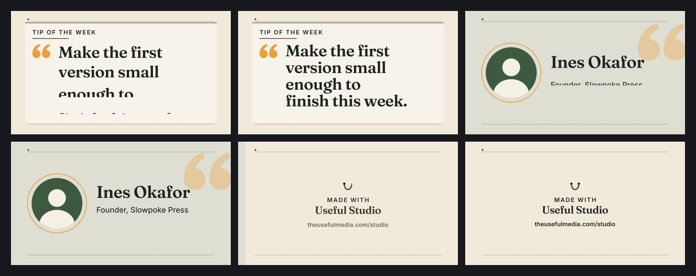
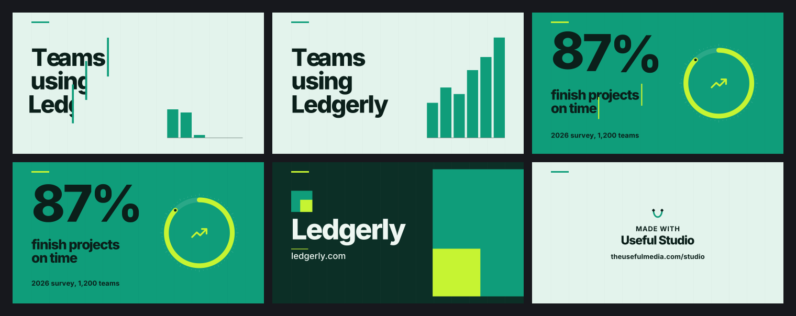
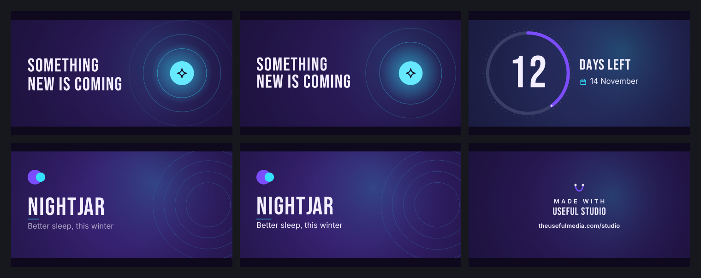

# 3 free video templates

3 short animated video templates you can make your own in your web browser. Type your words, pick your colours, and save an MP4. No app to install, no account and no internet connection needed.

They are made by Useful Studio, a motion design studio for Claude Code. Learn more at [theusefulmedia.com/studio](https://theusefulmedia.com/studio).

## The templates

### Quote card

A short quote or tip, set like a poster, then who said it. 3 looks: Editorial, Mono and Retro.

### Stat reveal

A big number rolls in on an odometer with a dial, a label and a source line, then your brand. 3 looks: Swiss, Neon and Calm.

### Countdown teaser

"Something new is coming", the days left in a ring, the date, and a teaser line. 3 looks: Cinematic, Neon and Playful.

Each template is 1 HTML file. Every video loops with no jump and can end with a small "Made with Useful Studio" card. The card is optional: untick it in the settings panel.

## How to use them

1. Download the file you want, for example **Quote card.html**, with the fonts folder next to it.
2. Double-click the file. It opens in your web browser and starts to play.
3. Change the settings in the panel: your words, your brand name, your 4 colours, the look, the fonts, the size (wide 16:9, tall 9:16 or square 1:1) and the end card.
4. Make your video in 1 of 2 ways:
   - Click **Export video**. Your browser makes an MP4 and downloads it.
   - Or click **Clean view** and record your screen. On a Mac, open QuickTime Player, choose File, then New Screen Recording, and record 1 full loop. Press Esc to bring the panel back.

Your settings are saved in the page link, so a bookmark keeps them.

## Browsers that work

- Chrome and Edge: play and export.
- Safari 16.4 or later: play and export.
- Firefox: play. Export works in recent versions. If the Export button is hidden, record your screen instead.

## License in plain words

You may use the videos you make for anything, personal or commercial, for yourself or for clients. The end card is optional. You may not sell, share or upload the template files, or put them in another product: point people to this page instead. They are free, so there are no refunds. The fonts are free fonts under the SIL Open Font License 1.1, with their licenses in the fonts folder. The full text is in [LICENSE.md](LICENSE.md).

## Want more?

The Useful Studio template pack has 10 templates and 12 looks. Useful Studio itself is a motion design studio for Claude Code that makes brand films, reels and explainers from a few questions. See [theusefulmedia.com/studio](https://theusefulmedia.com/studio).
